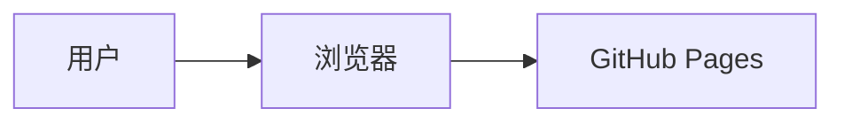

# 文章规则

## 目录

存放位置 + 命名规范：`_posts/<文章发布日期>-<文章英文 slug>.md`。

示例：`_posts/2025-06-27-cursor-vibe-coding.md`

## 元数据（Front Matter）

每篇文章开头必须包含以下 YAML 头：

```yaml
---
layout: post
title: <文章标题>
date: <文章发布日期>
categories: <分类>
tags: [<标签1>, <标签2>, <标签3>]
description: <文章摘要>
---
```

### `title`

文章标题。简洁明了，让读者一眼就知道文章主题。

### `date`

发布日期，格式 `YYYY-MM-DD`。应与文件名中的日期一致。

### `categories`

**一个文章只能有一个分类**。分类用中文。

分类按**体裁**划分，回答「这是一篇什么类型的文章？」，不按内容主题划分。一个文章只能有一个分类。

决定文章分类时，先在已有分类中寻找。如果现有分类都不合适，可以考虑新增分类。

已有分类：
- **教程** — 手把手、可复现的操作指南。判断标准：读者跟着做就能得到结果。
- **心得** — 方法论、经验总结、观点分享。判断标准：文章的核心价值是「我从实践中提炼出的想法」。
- **随笔** — 个人经历、生活记录、感悟。判断标准：文章的核心是「我的一段经历或一个念头」。

### `tags`

标签按**内容**划分，回答「这篇文章关于什么？」，一篇可以打 1-3 个。标签用中文或英文缩写（如 `AI`、`API`），YAML 列表格式：`tags: [AI, 自建服务]`。

标签设计原则：
- 标签之间用**英文逗号**分隔，不要用中文逗号。`[职场, 行动]` 而非 `[职场，行动]`。
- 标签之间不应有语义重复。例如已有 `AI` 就不应再用 `人工智能`。
- 一个标签应该能覆盖多篇文章，避免单篇专属标签。

决定文章标签时，先在已有标签中寻找。如果现有标签都不合适，可以考虑新增标签。

已有标签及其覆盖范围：
- `职场` — 职场观察、工作方法、效率与生产力
- `AI` — 大模型、AI 工具、AI 应用
- `自建服务` — 自托管服务的部署与配置
- `开发工具` — 开发效率工具与工作流
- `提示词` — Prompt Engineering、提示技巧
- `阅读` — 阅读方法与工具
- `行动` - 行动、践行、执行力
- `翻译` — 翻译相关
- `旅行` — 出行记录
- `写作` — 写作方法、写作习惯、写作心态
- `烹饪` — 烹饪技巧、厨房实践与食物制作
- `健康` — 身体健康、心理健康与生活状态
- `睡眠` — 作息与睡眠习惯
- `沟通` — 人际交流、沟通方式与关系互动
- `投资` — 投资理念、投资策略与市场观察

### `description`（推荐）

文章摘要，用于：
- 首页文章列表的摘要文字
- SEO 的 `meta description`
- RSS 订阅的摘要内容

如果不写 `description`，首页会自动截取文章开头前几句话作为摘要，效果不可控。**建议每篇文章都写**，长度控制在 1-2 句话。

示例：
```yaml
description: 分享使用 Cursor Agent 进行 vibe coding 的心得，以及如何通过任务拆解和上下文管理提升 AI 编码效率。
```

### `pin`（可选）

将文章置顶到首页，适合非常重要的文章或系列导读。

```yaml
pin: true
```

### `toc`（可选）

控制单篇文章是否显示目录（Table of Contents）。全局默认为 `true`，如果某篇文章不需要目录，可以关闭：

```yaml
toc: false
```

### `comments`（可选）

控制单篇文章是否开启评论。全局默认开启，如果某篇文章不需要评论区：

```yaml
comments: false
```

## 图片

### 存放位置

```
assets/images/<文章 slug>/<图片序号>.<扩展名>
```

示例：`assets/images/deploy-openwebui/1.png`

对于外部图片，推荐直接下载到本地，而不是用外部链接引用。

### 引用图片

**推荐使用 `media_subpath`** 简化图片引用。在 Front Matter 中设置：

```yaml
media_subpath: /assets/images/<文章 slug>/
```

之后在正文中只需写文件名：

```markdown

```

### 图片尺寸

图片应标注宽高，防止页面加载时布局抖动：

```markdown
{: w="700" h="400" }
```

### 图片标题

截图应有标题说明。

在图片下一行写斜体文字，会自动渲染为图片标题：

```markdown
{: w="700" h="400" }
*这里是图片标题*
```

### 截图阴影

截图类图片建议加阴影效果：

```markdown
{: .shadow }
```

### 图片格式与压缩

截图类图片使用 **PNG** 格式，照片类图片使用 **WebP** 格式。所有图片在提交前必须压缩。

| 图片类型               | 格式 | 工具       | 质量参数          | 预期缩减 |
| ---------------------- | ---- | ---------- | ----------------- | -------- |
| 截图（UI、终端、图表） | PNG  | `pngquant` | `--quality=70-90` | 60-80%   |
| 照片（实景拍摄）       | WebP | `cwebp`    | `-q 80`           | 90%+     |

**截图压缩（pngquant）**：

```shell
pngquant --quality=70-90 --ext .png --force image.png
```

**照片转 WebP（cwebp）**：

```shell
cwebp -q 80 photo.png -o photo.webp
```

> 如果原始照片已是 JPEG，也可以用 `-q 80` 参数转为 WebP，或保持 JPEG 格式用 `jpegoptim` 压缩。

**提交前检查**：单张图片不应超过 500KB。

## 正文排版

### 中英文与数字间距

中文与英文、阿拉伯数字之间使用一个半角空格。

- `有 100 个`，而不是 `有100个`
- `一个叫 Amy 的女孩`，而不是 `一个叫Amy的女孩`

以下情况不添加空格：

- 中文标点与英文或数字之间：`你好，Amy。`
- 数字与百分号等符号之间：`增长 10%`
- 代码、命令、文件名和 URL 内部

### 提示块（Prompts）

Chirpy 支持四种提示块，用 blockquote + class 实现：

```markdown
> 温馨提示内容
{: .prompt-tip }

> 补充信息
{: .prompt-info }

> 注意事项
{: .prompt-warning }

> 危险警告
{: .prompt-danger }
```

**使用建议**：
- `.prompt-tip` — 小技巧、最佳实践
- `.prompt-info` — 补充说明、背景知识
- `.prompt-warning` — 需要注意的坑、限制
- `.prompt-danger` — 可能导致严重后果的操作

### 引用

直接引用他人的原话（书籍、文章、演讲、对话等），使用标准 Markdown 引用块加署名。

**基本格式**：

```markdown
> 引用正文
>
> -- 作者名
```

多段落引用时，段落间用空引用行（`>`）分隔，署名放在最后：

```markdown
> 第一段内容
>
> 第二段内容
>
> -- 作者名
```

**署名扩展**：如果引用来自书籍或具体出处，署名可以附带出处信息：

```markdown
> 引用内容
>
> -- 作者名，《书名》
```

**与提示块的区别**：引用他人表达时，不要使用 `{: .prompt-* }` class。提示块用于编辑性标注（技巧、警告等），引用块用于呈现外部内容。

**外部服务与工具**：文章涉及外部服务或工具时，应附上官方文档链接，方便读者核实信息和进一步查阅。

### 代码块

代码块应标注语言，方便语法高亮。格式：```` ```语言 ````

语言标记常用：`yaml`、`shell`、`python`、`markdown`、`json`。

可以附带文件名：

````markdown
```yaml
key: value
```
{: file="_config.yml" }
````

### 交叉引用

引用站内其他文章使用 Jekyll 的 `post_url` 标签：

```liquid
[文章标题]()
```

### 术语与概念引用

当文章引入一个特定领域的概念或术语时，使用 `中文（[英文术语](URL)）` 格式，方便想进一步了解的读者查阅。

```markdown
我接触到一个方法论，自由写作（[free writing](https://en.wikipedia.org/wiki/Free_writing)）。
```

**英文术语的大小写**：遵循源语言的标准惯例。普通名词、方法、技巧名用小写（如 `free writing`、`self-perception theory`、`large language model`），专有名词保留原有的首字母大写（如 `ChatGPT`、`iPhone`）。

**链接选择**：
- 对于有 Wikipedia 页面的概念，优先链接至 Wikipedia
- 对于其他概念，可链接至官方文档或权威来源
- 如果该概念没有合适的参考页面，可省略链接

### 脚注

脚注用于补充说明或标注引用来源，不应承载理解正文所必需的信息。

- 正文中使用 `[^1]` 标记脚注，编号按脚注首次出现的顺序从 `1` 开始递增
- 脚注定义统一放在文章末尾，并按编号排列
- 正文结束后依次添加分割线和 `## 脚注` 二级标题
- 没有脚注的文章不添加「脚注」章节

```markdown
这是一段文字[^1]。

---

## 脚注

[^1]: 这是脚注内容。
```

### Mermaid 图表（可选）

如果需要画流程图、时序图、架构图，可以使用 Mermaid。先在 Front Matter 中启用：

```yaml
mermaid: true
```

然后在正文中：

````markdown

````

## 写作风格 & 文章质量要求

价值：
- 最重要的标准：长期来看，对读者有价值
- 教程类文章要提供可复现的步骤

表达：
- 基本要求：逻辑清晰、文字通顺
- 白描为主，只交待动作、场景与事实。拒绝“让人崩溃”、“干货满满”这类替读者预设情绪和价值判断的词汇。
- 按逻辑或时间顺序推进，用动词驱动句子，减少名词化表达。
- 拒绝欧化表达，减少没必要的修饰词、被动语态及生硬连词
- 句法紧实，多用短句，少用长定语
- 按逻辑或时间顺推。少用“和”、“了”

节奏：
- 松紧交替，连续高强度段落之后插入舒缓过渡（气口）
- 观点讲七分留三分，把事实推到读者面前就收手，不替读者下结论

多用名词、动词，少用形容词和副词。少用“的”和“了”。
